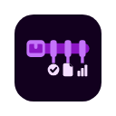

<p align="center">
  
</p>

<h1 align="center">Scholar Utility Belt</h1>

<p align="center">
  Local-first productivity tooling for Google Scholar.
</p>

<p align="center">
  <a href="https://chromewebstore.google.com/detail/scholar-utility-belt/omcogfcgldfmihfogbffflbocdbjockn"></a>
  <a href="https://github.com/BenAmpel/ScholarUtilityBelt/stargazers"></a>
  
  <a href="https://doi.org/10.5281/zenodo.18645552"></a>
  <a href="LICENSE"></a>
  <a href="https://buymeacoffee.com/bampel"></a>
</p>

Scholar Utility Belt is a Manifest V3 browser extension for Google Scholar that adds local-first research workflow support directly inside Scholar result pages and author-profile pages. The project is designed around one constraint: enrich the literature review experience without turning Scholar into a heavy network client or sending a user’s reading behavior to a remote service.

The extension layers paper triage, venue quality signals, lightweight bibliometric indicators, author-page tooling, and a local library on top of the existing Scholar interface. Most features are computed from the current DOM and packaged datasets, with external lookups used selectively and transparently.

<p align="center">
  
</p>

## At a glance

- Works directly on Google Scholar result pages and author profiles
- Keeps saved papers, notes, tags, and settings in browser storage
- Uses packaged venue-quality datasets for most ranking signals
- Adds bounded optional enrichment from public scholarly APIs
- Avoids a project-run backend or telemetry pipeline

## Key features

- [x] Search-result action grid for save/remove, PDF, abstract, and citation utilities
- [x] Venue-quality badges from FT50, UTD24, ABDC, VHB, ABS/AJG, CORE/ICORE, CCF, SCImago, ERA, Norwegian register, and related sources
- [x] Local-first `Emerging` and citation-velocity signals, retraction-watch and tortured-phrase (paper-mill) screening badges, to reduce scan time on dense result pages
- [x] Query Trend Tracker: year-distribution chart, OpenAlex rising-concept chips, and method-keyword pills for the current search
- [x] Author-profile filters, summary metrics, and compare-author overlays
- [x] Extended bibliometrics: p-index, Field-Weighted Citation Impact, Relative Citation Ratio (NIH iCite), Influential Citations (Semantic Scholar), and an auto-generated narrative CV
- [x] Citation-lineage/idea-lineage views and an interactive citation-graph overlay for exploring a paper's or author's citation network
- [x] Systematic-review workspace: multi-reviewer screening, PICO fields, PRISMA flow diagrams, and CSV/BibTeX/Markdown export
- [x] Publish-or-Perish-style report with peer-cohort benchmarking
- [x] Your own journal list: upload a CSV of venues and tier labels (a department or institutional list) and matching venues get a badge with your label; free for everyone, stored only in your browser
- [x] Reference import for the review workspace (Pro, unlocked by trial, purchase or App Pass): bring RIS or BibTeX exports from PubMed, Scopus, Web of Science or a reference manager into a review project, matched by DOI then title, with a search log for the PRISMA-S methods section
- [x] Local saved-paper library with notes, tags, collections, export/import
- [x] Configurable options page for feature toggles, quality sources, and enrichment behavior

Author compare, citation lineage, the extended bibliometrics, narrative CV, the review workspace, the citation-graph overlay, and the Publish-or-Perish report are part of **Scholar Utility Belt Pro** for new installs — see [A note on the Pro tier](#a-note-on-the-pro-tier). If you installed the extension before this tier shipped, every one of these stays free for you, permanently. Pro features added in later versions are not covered by that promise. New installs can start a 14-day free trial. Version 1.0.0 added a set of newer Pro features (reference import and review tools, result signals, Zotero, Obsidian, LaTeX and Word exports, library tools, a bibliography checker, a tenure packet and optional AI features); those need a trial, a purchase or App Pass for everyone.

## Links

- Chrome Web Store: [Scholar Utility Belt](https://chromewebstore.google.com/detail/scholar-utility-belt/omcogfcgldfmihfogbffflbocdbjockn)
- Repository: [github.com/BenAmpel/ScholarUtilityBelt](https://github.com/BenAmpel/ScholarUtilityBelt)
- Archived release DOI: [10.5281/zenodo.18645552](https://doi.org/10.5281/zenodo.18645552)

## Why this exists

Google Scholar is unusually good at broad discovery, but it is intentionally sparse. Researchers still have to do a lot of manual work:

- deciding which results deserve immediate attention
- distinguishing strong venues from weak or ambiguous venues
- spotting promising recent papers with low raw citation counts
- comparing author profiles beyond the default Scholar metrics
- saving, tagging, and revisiting papers without leaving the search flow

Scholar Utility Belt addresses those gaps in-place. Instead of replacing Scholar, it augments the page the user is already using.

## Core capabilities

### Search-result augmentation

- Quality badges from local journal and conference lists, including FT50, UTD24, ABDC, VHB, CORE/ICORE, CCF, SCImago quartiles, ABS/AJG, ERA, Norwegian register, and venue h5 where available.
- Result-level action grid for common tasks such as save/remove, copy citation snippets, open PDFs, abstract toggles, and lineage exploration.
- Local-first “Emerging” scoring that compares a paper against venue/year cohorts, with bounded fallback to external sources when local evidence is sparse.
- Citation-velocity and skimmability cues intended to lower scan cost on dense result pages.
- Retraction-watch and tortured-phrase (paper-mill/plagiarism-evasion) screening badges.
- Query Trend Tracker: a collapsible panel showing the year distribution, OpenAlex "rising concepts," and detected method keywords for the current search.
- An OpenAlex "Related works" panel alongside the result filters.
- Optional result filtering, grouping, hiding, and sort overlays that run client-side.

### Author-profile augmentation

- Additional author summary metrics beyond the default Scholar profile view (h-index, m-index, g-index, L-index, h5-index, and more).
- Local filters for venue quality, author position, coauthors, citation bands, and topic terms.
- **Pro:** compare-authors overlay for side-by-side profile analysis.
- **Pro:** extended bibliometrics — p-index, Field-Weighted Citation Impact, Relative Citation Ratio (NIH iCite), and Influential Citations (Semantic Scholar) — plus an auto-generated narrative CV built from those numbers.
- **Pro:** citation-lineage/idea-lineage views and an interactive citation-graph overlay, both built from bounded external enrichment.
- **Pro:** Publish-or-Perish-style report with peer-cohort benchmarking.

### Library and workflow tooling

- Local saved-paper library with tags, notes, search, sorting, export/import, and collection-style organization.
- **Pro:** systematic-review workspace — multi-reviewer screening with blind mode, consensus/conflict detection, PICO fields, PRISMA flow-diagram export, and CSV/BibTeX/Markdown report export.
- Import merges instead of overwriting: papers are matched by DOI, then by normalized title; tags, collections and highlights are combined, differing notes are joined, and nothing is deleted. A summary shows how many papers were added, merged and unchanged, and the last import can be undone from a backup kept in extension storage.
- **Pro:** collection packets — export one collection as a `.sub.json` file (papers and tags; notes only if you tick a box) and import a packet from someone else. Packets carry a SHA-256 checksum that detects accidental damage. They are not signed, and the checksum does not prove who made a file.
- **Pro:** library similarity — a "Similar" action on each saved paper and a "Possible duplicates" view (for example a preprint and its published version), using word overlap in titles and abstracts or snippets, computed on your device with no model download. Merging a pair keeps both links.
- **Pro:** watch lists — save up to 20 searches or author names and see recent works from OpenAlex that you have not looked at yet, with the same quality badges as the library. Lookups run at most once per item per 24 hours, only while the library page or a Scholar page is open (there is no background timer and no notification). Failures back off.
- Popup and options pages for configuring badge sources, external enrichments, UI density, and quality datasets.

## Design principles

### Local-first

The extension prefers computation from the page already loaded in the browser and packaged data stored with the extension. Many features work without any additional network requests.

### Bounded enrichment

When external data is used, requests are deliberately constrained. The code uses caching, timeouts, and fallback behavior so enrichment does not dominate page rendering or make Scholar feel fragile.

### Scholar-preserving UX

The goal is to support Scholar workflows, not replace them. Controls are embedded into Scholar’s existing result structure and author tables rather than redirecting the user into a separate web app.

## Network and privacy model

Scholar Utility Belt does not require a backend service operated by the project. Data is stored in Chrome extension storage on the user’s machine.

Local-only or packaged-data features include:

- saved library state
- user settings
- venue-quality lists shipped with the extension
- cached page-visit and reading-load metadata
- many DOM-derived result annotations

### Requests to Google Scholar itself

Since 1.1.0 the extension asks Google Scholar for nothing you did not ask for. Opening a results page or an author profile sends Scholar no extra requests: profile stats cover the papers on screen, with a "Load all for full stats" button, and the Emerging score uses OpenAlex figures when a page has too few similar papers. Scholar is only contacted again when you press a button: Load all, Load more pages, Copy BibTeX, the abstract and venue lookups, or Compare authors (at most five requests of 100 papers each, 1.2 seconds apart). If Scholar answers with a "not a robot" check or a rate limit, those features stop and wait 15 minutes before asking again, in every tab. Two Options switches bring back the old automatic behavior for people who want it. These page loads count toward Scholar's own limits, which is why they are opt-in.

### Every host the extension contacts

Nothing is sent to a server run by the project. These are all the places the extension talks to, what each receives, and when. Every request goes straight from your browser to the service, which handles it under its own policy.

| Service (host) | What is sent | When |
|---|---|---|
| [OpenAlex](https://openalex.org/) (`api.openalex.org`) | DOI, title, author name or search text; your optional API key and a placeholder `mailto` | Citation metrics, p-index and FWCI, the trend panel, related works, the citation graph, and watch lists (only if you add watch items). Also the librarian report page (Pro): the names, institutions and ORCIDs you type, only when you press "Find authors" |
| [Crossref](https://www.crossref.org/) (`api.crossref.org`) | DOI or a reference title | Per-result details and update status in the detailed view; the bibliography checker's "Check DOIs" button |
| [Unpaywall](https://unpaywall.org/) (`api.unpaywall.org`) | DOI and a placeholder email | Open-access status, per result in the detailed view |
| [OpenCitations](https://opencitations.net/) (`opencitations.net`) | DOI | Citing-works counts, per result in the detailed view |
| [DataCite](https://datacite.org/) (`api.datacite.org`) | DOI | Dataset and software links, per result in the detailed view |
| [Semantic Scholar](https://www.semanticscholar.org/product/api) (`api.semanticscholar.org`) | DOI; author name | Influential citations per result in the detailed view; author-profile metrics |
| [arXiv](https://arxiv.org/) (`export.arxiv.org`) | arXiv id | arXiv-listed results in the detailed view |
| [Europe PMC](https://europepmc.org/) (`www.ebi.ac.uk`), [NCBI E-utilities](https://www.ncbi.nlm.nih.gov/books/NBK25501/) (`eutils.ncbi.nlm.nih.gov`) | DOI, PubMed id or PMC id | PubMed-indexed results in the detailed view |
| [NIH iCite](https://icite.od.nih.gov/) (`icite.od.nih.gov`) | PubMed ids | Relative Citation Ratio on author profiles (PubMed-indexed works only) |
| [ROR](https://ror.org/) (`api.ror.org`) and [DBLP](https://dblp.org/) (`dblp.org`, `sparql.dblp.org`) | Affiliation text; co-author name | Co-author and affiliation insights, when that panel is open on an author profile |
| [Overleaf](https://www.overleaf.com/) (`www.overleaf.com`) | The LaTeX source you are shown first: the chosen papers' titles, authors, years, venues, DOIs, links, tags and abstracts; your private notes only if you tick a box that is off by default | Only when you click "Send to Overleaf" in the LaTeX citation pack (Pro). It is a form posted from your browser in a new tab, so it is not a fetch and is not on the extension's fetch allowlist (`url-policy.js`); no permission is involved |
| [SCImago](https://www.scimagojr.com/) (`www.scimagojr.com`) | The year you picked, nothing else | Only when you press the download button for rankings in Options |
| [ExtensionPay](https://extensionpay.com/) (`extensionpay.com`) | A random per-install key | Pro checks, after you start a trial or unlock (see the Pro note below) |
| joinapppass.com | Your joinapppass.com login cookie | Only if you opt in to App Pass in Options |
| An AI provider you choose (Anthropic, OpenAI or Google Gemini) | Your question and the saved text of the papers you select | Only "Ask my shortlist", after you confirm what will be sent |
| Publisher sites (any host) | The paper's URL, no cookies | PDF page counts, hover summaries and "Copy BibTeX from publisher". These need the optional all-sites permission you grant in Options, and run only on your click or hover |

The services in the first nine rows are queried automatically for results in the **detailed** view, using the result's DOI (or arXiv or PubMed id). **Options, Display Features, "Look up extra signals"** turns that off: with it off, nothing is sent for any result. Switching the view to minimal also stops them. Several of the other lookups run only on an author profile or only when you click.

The extension is built to minimize those calls and to make their effects legible in the UI.

**Watch lists send your queries to OpenAlex, but only if you add watch items.** A watch item is a search or an author name you type into the library page. Once one exists, the text of each item is sent to `api.openalex.org` (with your optional API key and the same `mailto` parameter other OpenAlex calls use) at most once per item per 24 hours, while the library page or a Scholar page is open. With no watch items, nothing is sent. Removing an item stops its lookups. Google Scholar itself is never fetched for this feature.

**A note on OpenAlex rate limits:** as of February 2026, OpenAlex asks unauthenticated callers to attach a free API key for reliable service. Without one, requests behind citation metrics, p-index/FWCI, trends, and related-works may be rate-limited or fail. Add a free key from [openalex.org/settings/api](https://openalex.org/settings/api) in Options → OpenAlex API key; the extension works without one but degrades gracefully.

### A note on the Pro tier

Scholar Utility Belt Pro (author compare, citation lineage, the extended bibliometrics, narrative CV, the review workspace, the citation-graph overlay, and the Publish-or-Perish report) is licensed through [ExtensionPay](https://extensionpay.com), which makes a network request to `extensionpay.com` to check your entitlement status. This is the one exception to the "no backend, no telemetry" design above — everything else in the extension still runs entirely from data already on the page or packaged with the extension, apart from the optional, user-initiated [AI features](#optional-ai-features-pro-off-by-default) below, whose only network call goes to the AI provider you choose with your own key. If you installed Scholar Utility Belt before this tier shipped, nothing changes for you: every one of these features stays free, permanently. That promise covers the features listed above; Pro features added in later versions need Pro for everyone (a purchase, the 14-day free trial, or App Pass). Starting the free trial or buying Pro goes through ExtensionPay, which collects your email address.

**App Pass (optional, off by default).** If you already subscribe to [App Pass](https://joinapppass.com), a single subscription that covers many browser extensions, you can turn it on in Options to unlock Pro with it. Nothing contacts `joinapppass.com` until you do. Once on, the extension asks `joinapppass.com` whether your pass is active (about every 6 hours once it is, or about every 10 minutes while you browse Scholar if no pass is found yet, so a new activation shows up quickly), sending this extension's ID and your `joinapppass.com` login cookie; App Pass uses those checks to share revenue between extensions. The answer, never your email, is cached locally. Turning it off in Options stops all contact. Anyone who bought Pro directly, or is grandfathered, is never checked.

### Optional AI features (Pro, off by default)

Two features use language models. Both are opt-in and neither runs unless you turn it on.

- **Triage cards** add a second line under a Scholar result with study design, sample and setting. They use Chrome's built-in Prompt API (Gemini Nano) on your device, so the snippet text is not sent anywhere by this extension. Whether that API is available depends on your Chrome version, device and settings; where it is missing the button explains that and nothing else changes. A value is shown only if it appears word for word in the snippet (a normalized comparison: case, spacing, dashes and thousands separators are ignored); otherwise the line says "not stated in snippet". This guarantees the text is in the snippet. It does not guarantee it is the right part of the snippet, so check the paper. Results are cached for the browser session.
- **Ask my shortlist** (Library page) lets you ask one question about papers you saved. You supply your own API key for Anthropic, OpenAI or Google Gemini in Options. **If you turn this on, the titles and the saved abstract or snippet text of the papers you select, plus your question, are sent to the provider you chose, under that provider's terms and privacy policy.** Nothing else is sent: no notes, tags, authors or links. Nothing is sent until you have seen the provider, the model, the number of papers, an estimated token count and cost, and the exact text, and pressed Send. The key is stored only in `chrome.storage.local` on this device, is not logged, and is sent only to the chosen provider's API host. The extension asks Chrome for that one host as an optional permission when you turn the feature on, and you can turn it off (this deletes the key and releases the permission) in Options. The cost estimate uses a price table you can edit; its built-in starting values were written from memory and may be out of date. The answer is a table with a verdict per paper and one quoted sentence; a quote is kept only if it appears word for word in the saved text, otherwise the row reads "no support found in the abstract". Saved text is the abstract when the paper has one, otherwise the Scholar snippet.

The project still runs no server and collects no telemetry; the only party that receives text in the second feature is the provider you picked.

## Packaged data sources

The repository includes local snapshots under [`src/data/`](src/data):

- `ft50.txt`
- `utd24.txt`
- `abdc2022.csv`
- `vhb2024.csv`
- `abs2024.csv`
- `fnege2025.csv`
- `core_icore2026.csv`
- `core_portal_ranks.csv`
- `scimago_2024_quartiles.json`
- `journal_impact_2024.csv`
- `quality_sources.json`

The new packaged `fnege2025.csv` is derived from the latest Harzing Journal Quality List title PDF (72nd edition, 27 March 2026). It reflects the JQL-covered journal set rather than the full FNEGE master list.

Quality-list refresh helpers live in [`scripts/update_quality_lists.py`](scripts/update_quality_lists.py) and related builder scripts.

## Installation

### End users

Install from the Chrome Web Store or load the repository as an unpacked MV3 extension.

Chrome Web Store:

- [Install Scholar Utility Belt](https://chromewebstore.google.com/detail/scholar-utility-belt/omcogfcgldfmihfogbffflbocdbjockn)

Load unpacked:

1. Open `chrome://extensions`
2. Enable `Developer mode`
3. Click `Load unpacked`
4. Select this repository root

The extension injects content scripts on Google Scholar domains configured in [`manifest.json`](manifest.json).

### Development

This repository is intentionally lightweight. The main runtime is plain JavaScript with no bundling requirement for extension development.

Useful entry points:

- content script: [`src/content/content.js`](src/content/content.js)
- service worker: [`src/sw.js`](src/sw.js)
- storage helpers: [`src/common/storage.js`](src/common/storage.js)
- venue-quality logic: [`src/common/quality.js`](src/common/quality.js)
- options UI: [`src/options/options.js`](src/options/options.js)
- library UI: [`src/library/library.js`](src/library/library.js)

## Repository layout

```text
src/
  common/      shared helpers for storage and venue-quality compilation
  content/     Scholar page augmentation logic and styles
  data/        packaged rank lists, quartiles, impact snapshots, and metadata
  library/     local saved-paper library UI
  options/     settings page for feature toggles and data management
  popup/       browser action popup
  whatsnew/    local what's-new page, opened once after an update
  sw.js        MV3 background service worker

scripts/
  update_quality_lists.py      refresh packaged venue-quality datasets
  build_* / parse_* helpers    data preparation and maintenance scripts
  playwright_*                 browser automation and smoke-test helpers
```

## Quality control

The project relies on a mix of parser-level checks, local data-build scripts, and browser smoke tests. The repository already includes Playwright-based verification helpers under [`scripts/`](scripts) and [`output/playwright/`](output/playwright).

Automated checks:

- `npm test`: unit tests for the shared modules and wiring.
- `npm run e2e`: the built extension in Microsoft Edge against local Scholar-shaped pages in `tests/e2e/fixtures` (every Scholar URL is answered locally, nothing reaches Google). It checks that badges render, that a results page and a profile visit send Scholar no extra requests, the custom list and Quick read filter, and that no page logs an error.
- `npm run a11y`: axe-core WCAG 2.1 AA checks of the extension's UI, light and dark.
- `npm run store-status`: the public version, users and ratings of each store listing.

Representative validation tasks include:

- syntax/build checks for core JavaScript modules
- content-script smoke tests on Scholar result pages and author pages
- release-candidate browser checks for first-load rendering and major workflows
- data-refresh scripts with row-count sanity checks for packaged rank sources

## Free tools from the same studio

Scholar Utility Belt is built by [Purplelink](https://purplelink.llc/?ref=scholar-utility-belt), which also runs a set of free web tools for academic writing. They are separate from the extension: nothing below is injected into Google Scholar pages, and the extension does not contact purplelink.llc.

- [BibTeX Validator](https://purplelink.llc/tools/bib-validator/?ref=scholar-utility-belt): checks a `.bib` file for syntax errors, dead DOIs, and wrong authors or years, and gives back a corrected file.
- [Citation Generator](https://purplelink.llc/tools/citation-generator/?ref=scholar-utility-belt): turns a DOI, arXiv ID, or ISBN into a formatted citation in APA, MLA, Chicago, or IEEE.
- [LaTeX to Word](https://purplelink.llc/tools/latex-to-word/?ref=scholar-utility-belt): converts a `.tex` file or project `.zip` into a double-spaced manuscript `.docx`.
- [Thesis Format Checker](https://purplelink.llc/tools/thesis-format-checker/?ref=scholar-utility-belt): checks a thesis or dissertation PDF for margins, font size, embedded fonts, page numbers, line spacing, and front matter, in your browser.
- [Replication Package Checker](https://purplelink.llc/tools/reproducibility-checker/?ref=scholar-utility-belt): checks a replication package zip for a README, license, pinned dependencies, a main script, absolute paths, random seeds, and missing data files, in your browser.
- [Guides](https://purplelink.llc/guides/?ref=scholar-utility-belt): how-to guides for LaTeX and academic writing, such as converting to Word, fixing BibTeX, citation styles, and word counts.
- [Paper Review](https://purplelink.llc/tools/paper-review/?ref=scholar-utility-belt): pre-submission review of a manuscript by four AI reviewers, from $9. The references are checked for free first.

## Citation

Use GitHub’s citation panel or the metadata in [`CITATION.cff`](CITATION.cff).

Current archived software DOI:

- [10.5281/zenodo.18645552](https://doi.org/10.5281/zenodo.18645552)

## JOSS materials

This repository includes Journal of Open Source Software submission materials in the standard JOSS manuscript format (`paper.md` plus `paper.bib`):

- [`paper.md`](paper.md)
- [`paper.bib`](paper.bib)

The current manuscript attributes the software to Benjamin M. Ampel, Georgia State University, and includes a JOSS-style AI usage disclosure.

## Limitations

- The extension is tightly coupled to Scholar’s DOM, so upstream Scholar markup changes can break parts of the UI.
- Some enrichments depend on third-party public APIs and may degrade under rate limits or transient failures.
- Packaged rank lists are snapshots; they need periodic refresh to remain current.
- Some curated data sources, such as the Harzing JQL-derived FNEGE file, intentionally reflect a filtered subset rather than a full official master list.

## License

This project is distributed under the ISC license. See [`LICENSE`](LICENSE).
